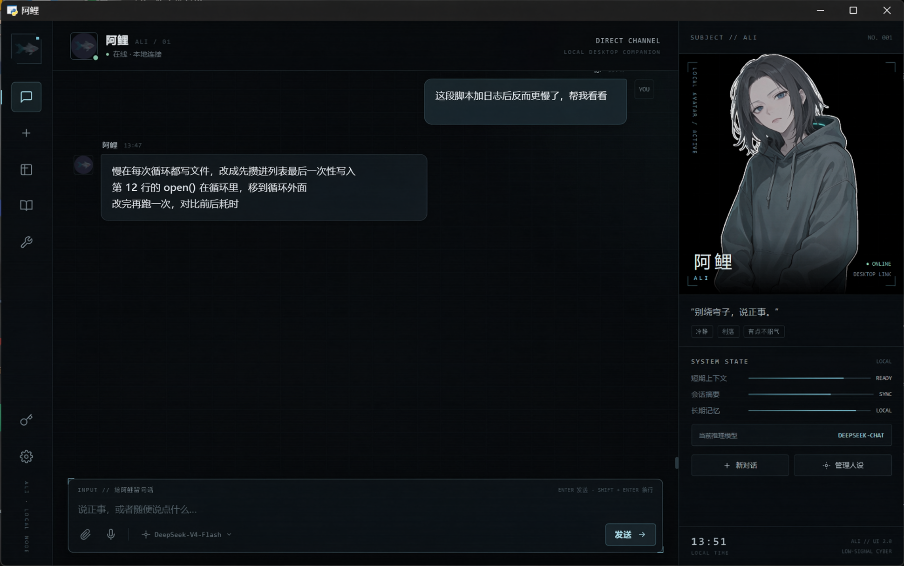

# 阿鲤 · AliCore

**v1.0.0** · 2026-11-27 · 更新内容见 [CHANGELOG.md](CHANGELOG.md)

运行在本机的桌面 AI 助手，由 `pywebview` 外壳、单文件 HTML 前端和 Python agent 内核组成。
支持对话、文件读写、代码执行与文档生成，内置一套可实际编译运行、带隐藏断言判题的 C/Python 教学靶场。

> **作者的话**：我一个人开发实在有心无力，成品难免粗糙，还望大佬们可以二次开发。



> 仓库仅包含代码、教程内容与示例配置。会话、记忆、学习进度和个人配置均存放于运行时目录；
> 语音音频不纳入仓库，缺少音频时使用 Windows 内置语音实时合成。

## 结构

```
AliCore/
├─ ali_app.py          # 入口：窗口 + API 薄壳
├─ ui_v2.html           # 单文件前端（HTML/CSS/JS 一体）
├─ alicore_agent/       # 内核：引擎 / 模型 / 工具 / 记忆 / 会话
├─ assets/              # 图标与立绘（不含语音）
├─ workspace/           # 靶场：40 课教程 / 练习模板 / 题库 / 分步导学 / 语音稿
├─ plugins/             # 插件库（默认空，只带 README 与 ext 示例）
├─ tools/               # GPT-SoVITS 语音合成辅助脚本
├─ tests/               # 冒烟自检，CI 也跑它
├─ .github/             # Issue / PR 模板与 Windows CI
├─ config.example.json  # 配置模板，复制成 config.json 再用
├─ requirements.txt
├─ CHANGELOG.md         # 更新记录
├─ NOTICE               # 第三方致谢与各项目许可证
├─ LICENSE              # 代码 MIT / 教程 CC BY-NC-SA 4.0
└─ ali_app.spec         # PyInstaller 打包配置
```

## 快速开始

### 方式一：使用预编译包

前往 [Releases](https://github.com/aliouidhau/AliCore/releases/latest) 页面下载 `alicore-v1.0.0.zip`（约 64 MB），解压后双击 `阿鲤.exe` 启动。

整个 `阿鲤` 文件夹需要一并保留。程序界面、教学靶场与运行依赖位于 `_internal` 目录，单独复制 exe 无法运行。

`plugins/` 与 `config.example.json` 位于 exe 同级目录，分别用于安装插件和生成配置文件。

### 方式二：从源码运行

环境要求：Python 3.12。

1. 安装依赖

   ```
   pip install -r requirements.txt
   ```

2. 接入模型

   首次启动时模型列表为空，需要手动接入一个 OpenAI 兼容接口。

   - 点击输入框右侧的模型按钮，选择「接入 API」
   - 填写服务商名称、Base URL 与 API Key
   - 程序会请求 `GET {Base URL}/v1/models` 校验连通性，能够取到模型列表才算接入成功
   - Base URL 填写到 `/v1` 为止，例如 `https://你的中转站地址/v1`；只填域名时程序会自动补全
   - API Key 保存在 `%APPDATA%\AliCore\secrets.json`，不写入 `config.json`，也不传给前端
   - 当前仅支持 OpenAI 兼容协议，Anthropic 原生协议不支持

3. 启动

   ```
   python ali_app.py
   ```

4. 进入靶场

   点击左侧「工作空间」。教程区只读，练习区可修改，实战模式带自动判题。

5. 安全模式

   ```
   python ali_app.py --safe-mode
   ```

   仅加载只读工具并强制使用 JSON 通道，不执行任何写操作。用于排查启动失败或工具误操作。

## 环境变量

| 变量 | 作用 | 缺省 |
|---|---|---|
| `ALICORE_DATA_DIR` | 数据目录 | `%APPDATA%\AliCore` |
| `ALICORE_RUNTIME_DIR` | 运行时目录（TCC / Blender / Graphviz 缓存） | `<data>\_runtime` |
| `ALICORE_SECRETS` | secrets.json 路径（测试隔离用） | `<data>\secrets.json` |
| `ALICORE_PLUGIN_LIB` | 插件库根目录 | `app\plugins` |
| `ALICORE_SW_EXE` | `SLDWORKS.exe` | 自动探测常见安装位置 |
| `ALICORE_BLENDER_EXE` | `blender.exe` | `<runtime>\blender\blender.exe` |
| `ALICORE_DOT_EXE` | Graphviz 的 `dot.exe` | 运行时包 / 常见安装位置 / PATH |
| `ALICORE_TTS_HOME` / `_REF` / `_PROMPT` | GPT-SoVITS 合成（仅在 tools 脚本中使用） | 不设置则使用 SAPI5 |
| `ALICORE_AUTO_ALLOW` | 跳过工具确认弹窗（自行承担风险） | 关闭 |

## 靶场内容

- **41 份教程**：Python 25 份、C 16 份，围绕机械专业场景（零件计算器、库存报表、成绩管理）
- **练习模板**：45 个起始文件，修改后可直接运行，`.c` 由 TinyCC 编译
- **实战题库**：88 道（改错、写原理、从零编写），C 题目使用隐藏断言判分
- **分步导学**：40 课 × 6 步，数据见 `workspace/lesson_steps.json`

C 语言需要 TinyCC，仓库不包含编译器。首次打开 C 教程或 C 题目时会提示下载，点击「下载并启用」后
从 GNU Savannah 官方镜像获取 `tcc-0.9.27-win64-bin.zip`（约 0.5 MB），解压至
`<data>\_runtime\tcc\tcc\tcc.exe`，不写入系统目录，不需要管理员权限。也可手动放置，或用
`ALICORE_RUNTIME_DIR` 指向已有运行时。未安装仅影响 `.c`，Python 功能不受影响。

## 上下文与工具

- **历史**：默认按 `context_window` 计算字符预算（131072 上下文约 147k 字符），超出时才从最旧的会话开始丢弃。需要固定上限时填写 `history_char_budget`。
- **摘要**：默认在上下文占用达到 75% 时触发；`summary_every` 为 0 表示不按轮数摘要。
- **单条消息**：默认不截断。
- **推理强度**：设置面板可选，留空则不发送该字段。`low` / `medium` / `high` / `xhigh` / `max` 对应界面上的低 / 中 / 高 / 极高 / 最高。仅推理模型支持该参数（GPT-5 系列、o 系列，以及接受该参数的中转服务）；不支持的服务商会返回 400，因此默认不设置。

常驻工具（每轮固定加载，共 15 个）：

`read_file` / `list_files` / `write_file` / `edit_file` / `apply_patch` / `search_text` / `run_command` / `run_python` / `http_get` / `web_search` / `todo_write` / `todo_read` / `remember` / `search_memory` / `dispatch_subagent`

- `apply_patch`：一次提交多处修改的统一 diff，逐段精确匹配；匹配失败时报告具体段落，不会改动错行
- `run_command`：执行 git / npm / pip / pytest / 构建命令，可通过 `cwd` 指定工作目录
- `run_python`：在隔离环境中运行 Python，需要第三方库时使用
- `http_get`：抓取公网网页或接口，本机与内网地址会被拒绝
- `web_search`：联网搜索，需自行填写 key（Tavily / 博查 / Serper），仓库不内置任何搜索密钥
- `todo_write` / `todo_read`：多步任务先列清单，由模型更新进度
- `dispatch_subagent`：将独立任务派给子 agent；子 agent 拥有独立上下文，主对话只接收结论，且不可再派生

执行隔离：`sandbox: true`（默认）按 **Docker 断网容器 → cocoon 子进程 → 本地受限 exec** 顺序降级。每次 `run_python` 的返回会标注 `[docker·断网容器]` / `[cocoon·子进程]` / `[local·未隔离]`，可据此确认本次执行的隔离级别。

`run_command`、`run_python`、`edit_file`、`apply_patch`、`delete_file`、`move_file`、`open_path` 执行前会在界面弹出「允许一次」确认。安全模式下仅保留只读工具。

## 插件

仓库内置 8 个插件，按可独立运行的标准筛选：

| 插件 | 依赖 |
|---|---|
| 技能库 | 技能目录（可选） |
| SolidWorks 直驱 | SolidWorks + Millwright sidecar + pywin32 |
| 文档 OCR | Ollama + `deepseek-ocr` 模型 |
| Blender 人物建模 / VRM 二次元 | Blender + MPFB2 / VRM addon |
| 架构图 | Pillow；安装 Graphviz 后使用自动布局 |
| 白板 / 数据库建模 | 已构建的前端 `dist` |

三维建模（cadquery/trimesh）、Umi-OCR、distill 记忆去重、supermemory 四类插件依赖较重，默认未启用；
相关实现仍在 `plugins.py` 中，需要时可在 `build_plugins()` 里恢复。

插件库未纳入仓库（含 node_modules，约 4.4 GB）。可放入 `plugins/` 目录，或用环境变量指定路径：

```bat
set ALICORE_PLUGIN_LIB=D:\你的路径\插件
set ALICORE_SW_EXE=D:\...\SLDWORKS.exe
set ALICORE_BLENDER_EXE=D:\...\blender.exe
set ALICORE_DOT_EXE=D:\...\dot.exe
```

### 添加插件

在 `plugins/ext/` 下放置一个 `.py` 文件，一个文件对应一个插件：

```python
PLUGIN = {"id": "my_plugin", "name": "我的插件", "category": "工具", "description": "..."}
TOOLS  = [{"name": "my_tool", "description": "给模型看的说明", "func": my_func, "tags": ("关键词",)}]
```

可选实现 `ready()` / `status()`，未实现时视为始终就绪。加载失败（语法错误、字段缺失、`func` 不可调用）只会跳过该文件，不影响内置插件。完整示例见 `plugins/ext/example_plugin.py`。

插件工具默认不进入常驻上下文（`json_visible=False`），通过 tags 命中或由用户在列表中点击「带入 →」加载，调用结束后即卸载，不修改全局开关。

## 语音

默认使用 **Windows 内置中文语音（SAPI5）**：免费、离线，讲解文字不会发送到任何服务器。首次播放时实时合成并缓存至 `<data>\_runtime\tts_cache`，同一段内容再次播放无需重新合成。点击「语音音色 ⚙」可查看当前引擎与两个音频目录。

如需使用自定义音色：

- 已有音频文件：教程音频放 `assets/voice/tutorial/<课key>/<节id>.wav`，练习音频放 `assets/voice/practice/<题id>.wav`。重启后优先使用自定义音频，缺失片段回落到内置语音
- 克隆音色：安装 [GPT-SoVITS](https://github.com/RVC-Boss/GPT-SoVITS)，使用 5 秒参考音频合成：

```
set ALICORE_TTS_HOME=D:\GPT-SoVITS
set ALICORE_TTS_REF=D:\voice_ref\my.wav
set ALICORE_TTS_PROMPT=参考音频里说的那句话

python tools/tutorial_voice_tts.py
python tools/voice_practice_tts.py
python tools/voice_normalize.py
```

## 数据位置

| 内容 | 默认位置 |
|---|---|
| 配置 / 会话 / 记忆 / 工作区 | `%APPDATA%\AliCore` |
| 日志 / 沙箱临时文件 | `%APPDATA%\AliCore\_runtime` |
| 密钥 | `%APPDATA%\AliCore\secrets.json` |

代码目录不会写入任何用户数据。如需更改位置：

```
python ali_app.py --data-dir D:\my-alicore-data --runtime-dir D:\my-alicore-runtime
```

或设置环境变量 `ALICORE_DATA_DIR` / `ALICORE_RUNTIME_DIR`。

## 打包成 exe（可选）

```bat
pip install pyinstaller
pyinstaller ali_app.spec --noconfirm
```

产物位于 `dist\阿鲤\`，分发时需包含整个文件夹。界面、图标、40 课靶场、示例配置与 LICENSE 均打包在 `_internal` 目录；首次启动会将这些内容播种到 `%APPDATA%\AliCore\workspace`，此后读写的是数据目录中的副本，更换新版 exe 不会覆盖用户修改过的题库。`plugins` 与 `config.json` 放在 exe 同级目录，不打包进产物。实测体积约 143 MB（onedir）。

## 授权

| 部分 | 授权 |
|---|---|
| 代码 | **MIT**（见 LICENSE） |
| 教程 / 题库 / 分步导学（`workspace/`） | **CC BY-NC-SA 4.0**：可学习、可修改、可分享，不可商用 |
| 语音音频（`assets/voice/`） | 不随仓库分发（音色版权） |
| 立绘 / 图标 | 仅限作者自用，分发前请替换或确认版权 |

## 借鉴与致谢

本项目的若干核心设计借鉴自以下开源项目，包括直接沿用、改写和仅借鉴思路；具体实现位置见对应文件的注释。

| 来源 | 许可 | 用在哪 |
|---|---|---|
| [HuggingFace/smolagents](https://github.com/huggingface/smolagents) | Apache-2.0 | CodeAgent 通道的循环骨架（一轮一个代码块 → 执行结果回灌 → `done()` 收口）；跨轮持久命名空间；工具=普通函数、按函数签名生成 schema；执行护栏的数值 |
| [All-Hands-AI/OpenHands](https://github.com/All-Hands-AI/OpenHands) | MIT | UI / Agent / Runtime 的架构分层；Runtime 抽象（同一接口挂多套执行环境）；事件流（Action / Observation）；工具与 agent 解耦 |
| [princeton-nlp/SWE-agent](https://github.com/princeton-nlp/SWE-agent) | MIT | Agent-Computer Interface（ACI）的若干硬规则：编辑前先过 linter、空结果必须明确说明「执行成功但未命中」 |
| [Aider-AI/aider](https://github.com/Aider-AI/aider) | Apache-2.0 | 仅作对照，未沿用代码：`edit_file` 不做模糊匹配（aider 用约 20KB 处理该逻辑）；`code_map` 使用标准库 `ast` 而非其 repomap + tree-sitter |
| [deepseek-ai/deepseek-harness](https://github.com/deepseek-ai/deepseek-harness) 及其生态 | MIT | HTTP 退避重试（dsh-llm-retry）；规则式偏好捕获、凭证脱敏（dsh-engram，npm 包，维护者 skepsun） |

BM25 打分公式出自信息检索的公开文献（Robertson & Zaragoza, 2009），实现按公式自行编写。

完整的版权归属、各项目许可证位置与运行时依赖许可清单见 [NOTICE](NOTICE)。

## 已知限制

- 仅在 Windows 上验证（pywebview 使用 WinForms 后端）
- 代码执行默认使用 Docker；未安装 Docker 时降级为本地受限执行
- 不提供安装器与自动更新
- 个人项目，测试集中在核心链路
- 教程围绕机械专业场景编写，不是通用教材
